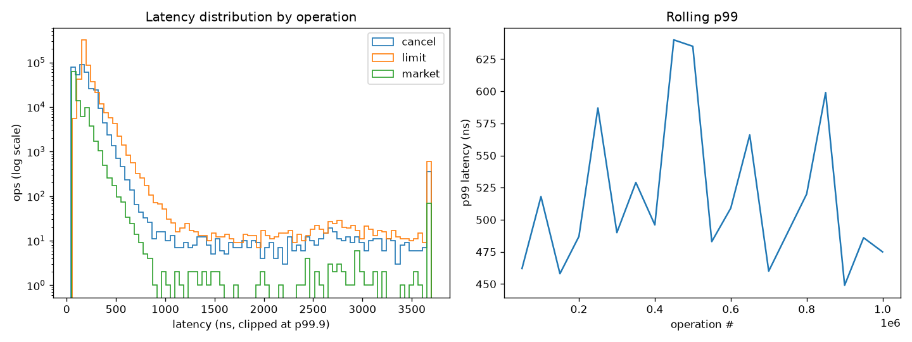

# matchbook

[](https://github.com/aaryank077/matchbook/actions/workflows/ci.yml)

A limit order book matching engine in C: the core of a stock exchange. It
takes buy and sell orders, matches them by price-time priority, and reports
trades. It has a checksummed write-ahead journal for crash recovery, a
differential fuzzer that checks every result against a Python reference model,
and a pandas analysis of per-order latency.

**6.5–8M orders/sec in a single thread, with a 250 ns median and a ~700 ns p99 for limit orders**
(Intel Core i5-1038NG7, macOS, 5M-order synthetic workload).



## How it works

```
orders ─► parse ─► journal (WAL + CRC-32) ─► match ─► trades
                                               │
                     price-indexed levels ◄────┤  best bid / ask
                     FIFO per level (intrusive list)
                     order pool (preallocated) + id → order hash map
```

| Piece | What it does | Why |
|---|---|---|
| `include/list.h` | Intrusive doubly linked list (the Pintos kernel's design) | Each price level's FIFO keeps arrival order; an order can be unlinked in O(1) from a pointer to it |
| `src/pool.c` | Fixed-size object pool with a free list threaded through unused slots, like a kernel slab cache | No `malloc` on the matching path; alloc/free are O(1) |
| `src/idmap.c` | Open-addressing hash map with linear probing and backward-shift deletion | O(1) cancel by order id, with no tombstones piling up under heavy cancel traffic |
| `src/book.c` | Price levels as a directly indexed array of integer ticks | Finding a level is one array access; prices never touch floating point |
| `src/journal.c` | Write-ahead log of fixed 32-byte records, each ending in a CRC-32 | On restart, replays valid records and truncates a torn tail, then the book is exactly as it was |

**Matching rules:** the best price fills first, and the oldest order at a price fills first. Trades
happen at the resting (maker) order's price. A limit order's unfilled remainder rests in the book. A
market order's unfilled remainder is discarded. Rejects: `BAD_ID`, `DUP_ID`, `BAD_PRICE`, `BAD_QTY`,
`FULL` (order pool exhausted), `UNKNOWN_ID` (cancelling an order that isn't resting).

## Usage

```bash
make            # build/matchbook and build/bench
make test       # C unit tests under sanitizers
make fuzz       # 300 differential + crash-recovery runs against tools/reference.py
make bench      # throughput and latency percentiles
make analyze    # pandas latency report + chart (pip install -r analysis/requirements.txt)
```

The CLI reads one order per line and writes trades and rejects:

```
$ printf 'L 1 S 101 5\nL 2 S 100 5\nL 3 B 101 8\nC 1\nP\n' | ./build/matchbook
T 2 3 100 5        # maker 2 sells 5 @ 100 to taker 3
T 1 3 101 3        # then 3 more from maker 1 @ 101
BOOK 0 0 0 0       # order 1 (2 left) cancelled; book is empty
```

Input: `L <id> <B|S> <price> <qty>`, `M <id> <B|S> <qty>`, `C <id>`, `X <id> <qty>` (reduce a resting order,
keeping its place in line, like an exchange feed's execution or partial cancel), `P` (print top of book).
Add `-j journal.bin` to make the book survive restarts.

## Correctness

- **21 C unit tests** cover price-time priority, partial fills, reducing an order without losing priority, trading at the maker's price, sweeping
  multiple levels, every reject, pool exhaustion, and the journal (CRC-32 test vector, bit flips, torn tails).
  They run under UBSan (and ASan on Linux).
- **Differential fuzzing** (`tools/fuzz.py`): random order flow with a tiny price range and id space,
  so orders constantly collide, cross and get reused. The C engine's output must match the
  ~110-line Python reference model byte for byte. 300 runs, 0 mismatches.
- **Crash-recovery fuzzing**: a quarter of fuzz runs write a journal, cut the file at a random byte
  (simulating a torn write), restart, and check that the engine behaves exactly as if only the
  fully written records had arrived.
- **The fuzzer catches real bugs**: planting a one-character off-by-one in best-ask tracking made
  39 of 40 runs fail.
- **A blind spot, fixed**: a market order could reuse a resting order's id and trade against itself.
  The reference model had the same gap, and the fuzzer only gave market orders fresh ids, so nothing
  caught it. Market orders now reject `DUP_ID` like limit orders, and the fuzzer reuses ids for them
  too (the old engine fails 12 of 40 runs).

## Performance findings

**Page faults on the hot path.** The first benchmark had a p99 of 3.6 µs for limit orders. The id hash
map was allocated with `calloc`, and for large blocks that returns untouched zero pages from `mmap`. The
first insert into each page took a page fault in the middle of matching. Touching every page once at
startup moved that cost out of the trading path:

| | Throughput | Limit p99 |
|---|---|---|
| Before (lazy `calloc` pages) | 5.45M orders/s | 3,577 ns |
| After (pre-faulted) | 6.5–8.1M orders/s | ~700 ns |

**Durability costs throughput.** The journal can `fsync` after every order (nothing acknowledged is
ever lost) or batch N orders per `fsync` (group commit: a crash or power failure can lose up to N−1 orders that were already acknowledged).
Measured end to end through the CLI, including text parsing, on 200k orders:

| Journal | Orders/sec |
|---|---|
| None | 756k |
| fsync every order | 11k |
| fsync every 64 | 197k |
| fsync every 1,024 | 495k |

**Tail latency is mostly the OS.** With `make analyze`, the pandas report shows the p99 holds at
450–640 ns across every 50k-order window. The rare 100 µs+ outliers hit all order types alike, which
points to interrupts and scheduling, not the matching code.

## OS concepts used

| Concept | Where |
|---|---|
| Intrusive lists, slab-style allocation | `list.h`, `pool.c` |
| Demand paging and page faults | Pre-faulting in `idmap.c`, measured above |
| Journaling, transaction checksums, crash consistency | `journal.c`, crash-recovery fuzzing |
| Durability vs. performance (`fsync`, group commit) | `--fsync-every`, measured above |

## Limitations and next steps

- Single-threaded. Next: a separate network/parsing thread feeding the matcher through a
  producer/consumer ring buffer.
- On macOS, `fsync` only reaches the drive's cache; true power-loss durability needs `fcntl(F_FULLFSYNC)`.
- Finding the next best price after a level empties scans tick by tick (fast when the book is
  dense near the top, slow if it's sparse). A bitmap of non-empty levels would bound this.
- No order modify/replace, IOC/FOK order types, or self-trade prevention yet.
